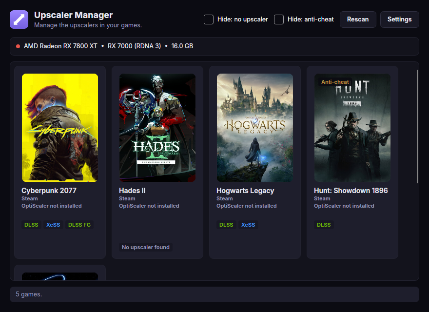
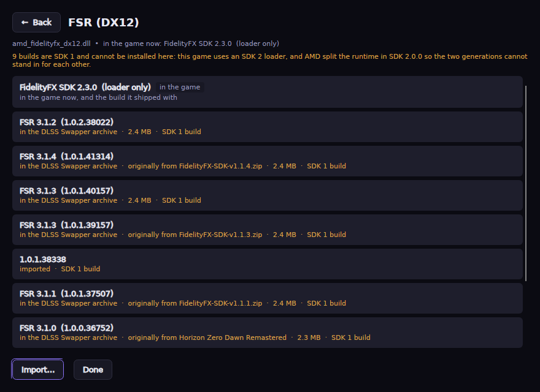
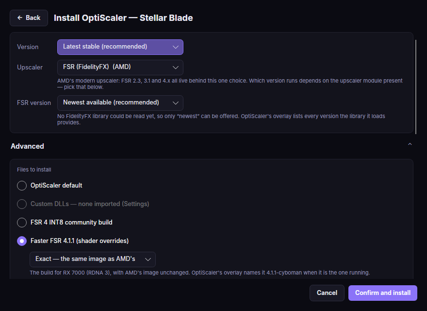
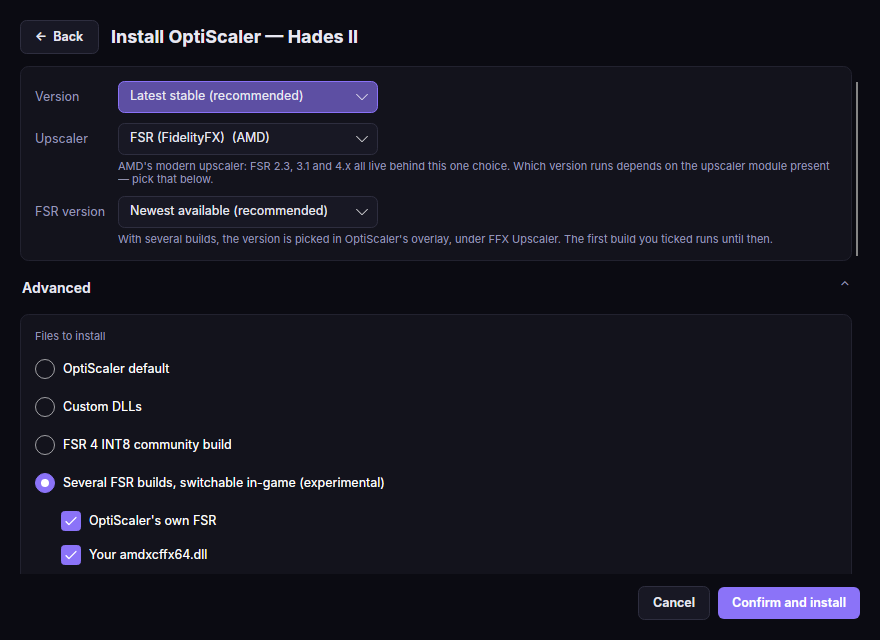

# Upscaler Manager


A **simple** desktop frontend for the upscalers in your games, on Linux first.

Two things a game might need, and this does both. Sometimes it needs
[**OptiScaler**](https://github.com/optiscaler/OptiScaler), so its existing DLSS option
can drive FSR or XeSS instead. Sometimes it just needs a **newer DLL** — a later DLSS,
FSR or XeSS build dropped in place. Either way you see exactly what will change before
anything is written, and everything is reversible.

> Windows is supported as the secondary target; macOS runs the UI. **This project is
> heavily AI-assisted** — see [How this project is built](#how-this-project-is-built).



<sub>Screenshots are rendered from the running app against a sample library.</sub>

## Get it

Download the archive for your platform from the
[latest release](https://github.com/filobus97/optiscaler-manager/releases/latest) and
run it. One self-contained binary: no runtime to install, and nothing written outside
the folder you unpacked and your config directory.

```bash
unzip UpscalerManager-<version>-linux-x64.zip -d ~/Apps/UpscalerManager
cd ~/Apps/UpscalerManager && chmod +x UpscalerManager && ./UpscalerManager
```

On Windows run `UpscalerManager.exe`. It updates itself from then on — **Settings →
Update now** downloads, applies and restarts, with no terminal, so it works in Steam
Gaming Mode.

## What it does

**Your games, as cards.** Cover art from Steam, the technologies each game already
carries, and whether OptiScaler is installed. A game that ships Easy Anti-Cheat,
BattlEye or Denuvo Anti-Cheat is tagged, and the toolbar can hide those games, or games
with no upscaler at all. A card has one action: open the game.

**One page per game**, with one primary action.

- **OptiScaler** — install it, or reinstall and remove it.
- **Upscaler libraries** — one row per swappable DLL the game has, reading
  `DLSS 310.1.0.0 → 310.9.1.0` with where the newer build comes from. **Update** opens
  every build this app can reach, newest first.
- **FSR 4 without OptiScaler** — for a game that ships AMD's FidelityFX files: pick an
  FSR 4 build, read the list of files it will write and which of the game's files each
  replaces, confirm, and **Undo** puts everything back as one unit.
- **Details**, collapsed: everything found next to the game, and what OptiScaler's ini
  is set to do.

**Builds come from four places**, and each row says which: your other games, the
OptiScaler releases already downloaded, files you import (DLLs or zips), and the
[DLSS Swapper](https://github.com/beeradmoore/dlss-swapper) archive of shipped builds.
Only the last needs the network, and it can be switched off.

**FSR has a guard nothing else has.** AMD split the FidelityFX runtime in SDK 2.0.0 —
a loader plus one module per effect — and made the loader compatible with the old
filename, so `amd_fidelityfx_dx12.dll` means two incompatible things. Both sides are
read out of the binaries, and a swap across that line is refused rather than left to
break the game silently. FSR 4 lives in a module most games do not ship at all, so a
swap cannot reach it; that is a separate, set-aware action (below), or OptiScaler's job.



**Stable, beta or nightly.** The install screen switches between OptiScaler's releases,
its pre-releases and its daily builds from
[`optiscaler/OptiScaler-nightly`](https://github.com/optiscaler/OptiScaler-nightly), each
with its own version list. Every source's list is refreshed in the background when the
app starts, and again by *Settings → Check for updates*, so a screen opens on current
versions.

**FSR 4 without OptiScaler.** A game on the SDK 2 split gets the FSR 4 upscaler under
its own name. A game on the SDK 1 runtime gets AMD's SDK 2 loader under the old name,
which AMD documents as compatible with it, with the FSR 4 upscaler and the frame
generation module beside it; where no loader is at hand the upscaler stands in alone, and
the page warns before you confirm that the game's own frame generation will not work. The
builds come from the same sources as the omniloader's, less the driver-style ones, and
the files are the ones the app already holds: the OptiScaler release's loader and
frame generation module, or DLLs you imported. It is refused while OptiScaler is
installed in the game, and OptiScaler is refused while it is in place. Not yet tried on a
real game: see [docs/fidelityfx.md](docs/fidelityfx.md).

**Installing shows the diff first.** Pick the release and the upscaler; everything else
has a default and lives under *Advanced*. The preview lists the exact files that will be
placed and the exact `OptiScaler.ini` keys that will change, and updates as you change
the options. Whatever is already there is backed up to a per-game store first, so
**Remove** puts it back. A game with anti-cheat gets a warning before anything else.

**Faster FSR 4.1.1, if you want it.** Under *FSR 4 from*, the
[FSR 4 shader overrides](https://github.com/zgauthier2000/fsr4-shader-performance-overrides)
replace OptiScaler's FSR 4.1.1 upscaler with AMD's own DLL, its slowest shaders
rewritten:
- **exact** keeps AMD's image byte for byte, about 25–30% cheaper at 4K on RX 7000;
- **lossy** is about twice as fast, softer, with frame times that alternate.

The build for your hardware is picked for you: one for RX 7000 and RX 6000 cards, one
for integrated graphics and the Steam Deck. It is refused on RX 9000, which runs a
different FSR 4 model. Turn the source on under *Settings → Sources* first; OptiScaler's
overlay then names the upscaler `4.1.1-cyboman` (`4.1.1-igpu-cyboman` on integrated
graphics, with `lossy` in the name for the lossy build) when it is the one running.



**FSR 4 on more GPUs, through AMD's own driver files.** Since driver 26.10.1, AMD's FSR 4
(4.1.2) carries four models: FP8 for RX 9000, INT8 for RX 7000, an INT8 model for RX 6000,
and a small INT8 Lite model for integrated graphics. The driver picks the one for the GPU.
- **On Linux** there is no AMD driver for OptiScaler to find them in. Once you import
  them, *FSR 4 from* on the install screen offers them by the FSR version they carry,
  picked by default, and places them next to OptiScaler. Before that, the same spot has
  an *Import AMD driver files…* button. On Windows your installed driver already
  provides them.
- **The model** can be picked at install for OptiScaler 10 and newer (`[FSR] Fsr4Model`),
  and changed later in OptiScaler's overlay.
- **Forcing FSR 4** on a GPU OptiScaler does not list is written under the name each
  release reads: `Fsr4GpuSupport` (10), `Fsr4ForceModel` (0.9.5) or
  `Fsr4ForceEnableInt8` (older). With no model picked it forces the GPU's own model, or
  INT8 Lite where FSR 4 has none, since Lite runs on any GPU.

**Several FSR builds, switchable in-game.** Under *FSR 4 from*, tick
any number of builds from every source that is on: OptiScaler's own, the faster 4.1.1
builds, each OptiScaler Client extras release, the DLLs you imported. The
[omniloader](native/omniloader/README.md) takes the place of OptiScaler's FSR upscaler,
loads them all, and lists every version they offer in OptiScaler's overlay under
*FFX Upscaler*, so you can compare them without restarting the game. The first build
ticked is the one the game starts on. AMD driver files can go behind it too, so two driver versions can be compared in
one session. OptiScaler's FSR 4 model choice and preset fixes do not reach builds behind
it yet.



**Reachable by D-pad throughout**, including the updater. It is meant to be used from a
Steam Deck in Gaming Mode: add it as a non-Steam game.

## What it will and will not download

The line is **redistributable or not**. Vendors publish the DLSS, FSR and XeSS SDK
libraries so they can ship inside games, and OptiScaler's releases bundle AMD's signed
FidelityFX DLLs on the same basis — those are fetched for you.

A binary its owner does not distribute separately is **never** downloaded, bundled or
linked. AMD's FSR 4 driver files are the example: `amdxcffx64.dll` (DirectX 12) and
`amdvkffx64.dll` (Vulkan) ship only inside the Adrenalin driver package, so they are
strictly bring-your-own. *Settings → Your own files → AMD driver FSR 4 files* takes them
from AMD's installer, an unpacked driver folder or the files themselves, checks that each
is AMD's driver file (it hands FSR 4 out through `UpdateFfxApiProvider`), and keeps one
copy per version.

Three third-party sources are listed by name under **Settings → Sources**, each with
its own switch. None is mirrored here, and each is used only when you pick one of its
builds:

- **DLSS Swapper archive** (on by default) — a mirror rather than the publisher, so it
  is labelled as one on every row and checked against the hashes its index publishes.
- **OptiScaler Client extras** (on by default) — the FSR 4 INT8 builds from
  [`Agustinm28/OptiScaler-Extras`](https://github.com/Agustinm28/OptiScaler-Extras),
  for hardware whose driver provides no FSR 4. They ship as
  `amd_fidelityfx_upscaler_dx12.dll`; any that ship as `amdxcffx64.dll` take the name of
  AMD's runtime, as a community replacement in the same slot, not AMD's binary.
- **FSR 4 shader overrides** (off by default) — AMD's FSR 4.1.1 DLL, which AMD's SDK
  licenses under MIT, modified by
  [`zgauthier2000/fsr4-shader-performance-overrides`](https://github.com/zgauthier2000/fsr4-shader-performance-overrides)
  under the GPL. Checked against the SHA-256 GitHub publishes, and as AMD's 4.1.1.2740,
  before it replaces anything.

## Build and test

```bash
dotnet build                                    # 0 warnings expected
dotnet test tests/UpscalerManager.Core.Tests    # the pure logic
native/omniloader/build.sh test                 # the omniloader (MinGW-w64), tested under Wine
tests/UpscalerManager.UiHarness/run.sh          # drives the real window, writes docs/screenshots
dotnet publish src/UpscalerManager.App -c Release -r linux-x64 --self-contained
```

CI builds and tests `linux-x64` and `win-x64`, and the omniloader, on every push to
`main`, and leaves both apps as downloads on the run (kept two weeks) for testing.
Releases carry the omniloader inside the app. A release is cut
by pushing a `v<version>` tag, or by pushing to `main` with `[release]` in the commit
message.

| Project | What it is |
| --- | --- |
| `src/UpscalerManager.Core` | UI-agnostic services: scanning, PE inspection, install, backup, swap. No Avalonia dependency. |
| `src/UpscalerManager.App` | The Avalonia UI. |
| `tests/UpscalerManager.Core.Tests` | xUnit tests for the logic that must not be wrong. |
| `tests/UpscalerManager.UiHarness` | Renders the real window headlessly against a sample Steam library in a throwaway HOME, checks what the screens show, and writes the screenshots. |

[`DESIGN.md`](DESIGN.md) is the design contract — palette, four type sizes, geometry,
and the rules for writing both UI text and code comments. If a screen disagrees with
it, the screen is wrong. Two decisions that need more than a comment are written up in
[`docs/fidelityfx.md`](docs/fidelityfx.md) (AMD's SDK split, the generation guard, and
the faster FSR 4.1.1 builds)
and [`docs/swapping.md`](docs/swapping.md) (what this takes from DLSS Swapper, and
where it differs).

## How this project is built

This project is **heavily AI-assisted**. Most of the code was written by
[Claude](https://www.anthropic.com/claude) working from direction, review and hardware
testing by the maintainer. Stated plainly so you can judge for yourself:

- Every change is covered by a test suite that must pass on Linux and Windows before a
  release publishes, and the UI is driven end-to-end by a harness that renders the real
  window rather than mocking it.
- Anything touching your game files goes through the backup-and-manifest layer, and the
  app shows the file and `.ini` changes before writing them.
- Several bugs were found by rendering screenshots and reading them; the commit history
  records those rather than hiding them.
- None of that makes it infallible. Bugs are the maintainer's responsibility — report
  them and they get fixed. **Settings → Open the log folder**; attaching that file helps
  most.

## Supporting the project

Optional, and nothing in the app is gated behind it. Channels are in
**[DONATE.md](DONATE.md)** — currently [Ko-fi](https://ko-fi.com/B2W426SLFP).

## Attribution & license

**License: [GPL-3.0-or-later](LICENSE).**

Upscaler Manager is built on the work of others and preserves their attribution:

- The reused service layer comes from
  **[OptiScaler Client](https://github.com/Optiscaler-Client/Optiscaler-Client)**,
  originally by **[Agustín Montaña (Agustinm28)](https://github.com/Agustinm28)**. It
  was taken from a personal fork of that project, which has since been realigned with
  upstream and carries nothing of its own.
- The mod this app configures is **OptiScaler**, by the
  [upstream OptiScaler team](https://github.com/optiscaler/OptiScaler).
- The swapper's design and its download archive come from
  **[DLSS Swapper](https://github.com/beeradmoore/dlss-swapper)**, by
  **[Brad Moore (beeradmoore)](https://github.com/beeradmoore)** and its contributors —
  also GPL-3.0. No code was copied; what was taken is the swappable set, the
  hash-then-extract download discipline, and the archive of vendor builds this app links
  to and does not mirror. The years of collecting those builds are the part that could
  not be reimplemented.

This program is distributed in the hope that it will be useful, but **WITHOUT ANY
WARRANTY**; without even the implied warranty of MERCHANTABILITY or FITNESS FOR A
PARTICULAR PURPOSE. See the GNU General Public License for more details.
